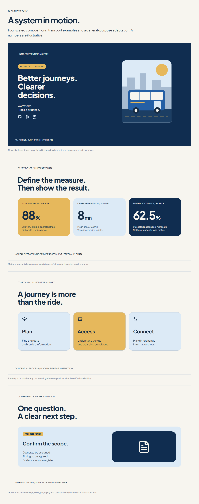

# LINTAS Design System

Navy/gold,people-centered presentation language with a general-purpose core and public-transport extension. Inspired by the reference's visual warmth;not an official Kemenhub identity.

## Start
Open index.html offline. All rules static,no runtime CDN or JavaScript. Plus Jakarta Sans is embedded in HTML and supplied as a local TTF with OFL. Lucide icons are inline and separately supplied with licence.

AI reading order:README → complete index.html → tokens.json → ICONS.md + icon-registry.json → SHAPES.md → CHARTS.md → AI-INSTRUCTIONS.md → STORYTELLING.md → VALIDATION.md.

## Files
- index.html:full documentation,31-icon gallery,shapes/masks,route demo,six charts,four slide compositions.
- tokens.json:explicit palette,type,geometry,image,chart and icon values.
- ICONS.md / icon-registry.json:14 construction/usage rules and31 semantic mappings.
- SHAPES.md:12 shape and12 image rules,exact window path,crop math,decorative vs real route contracts.
- CHARTS.md:28 analytical chart rules and12 transport measure definitions.
- example-data.json / transport-example-data.json:illustrative datasets with units/definitions,nulls and checked calculations.
- assets/fonts:unmodified Plus Jakarta Sans variable TTF and OFL.
- assets/icons:31 unmodified Lucide SVGs and licence.
- assets/illustrations:original synthetic bus scene and fictional schematic route.
- charts/:six standalone illustrative SVGs.
- asset-provenance.json / THIRD-PARTY-NOTICES.md:sources,hashes and licences.
- AI-INSTRUCTIONS.md / STORYTELLING.md:execution contract and bilingual narration.
- VALIDATION.md / contrast-report.json / CHANGELOG.md:actual checks and limits.
- lintas-preview.png / icon-preview.png:visual previews.
- lintas-design-system.zip:complete portable package.

## Prompt
Read LINTAS completely. Create [output] for[audience] to[purpose/outcome] using[sources,period/cutoff]. Language[language],mode[Read/Present],scope/brand[constraints],context[general/transport]. Apply icon,mask and chart rules,verify claims,flag critical gaps and inspect output.

## Scope
Documentation/assets/previews,not an actual client deck,PDF/Slides/PPTX master,interactive dashboard or operational signage standard. Reference font unidentified;Plus Jakarta Sans deliberately selected. SVG samples are not native editable chart objects. Synthetic illustrations are not documentary evidence. Variable-font support varies by editor;fallback disclosure and wrap QA required. No official Kemenhub colour or endorsement asserted. No source deck photographs/logo copied. LINTAS is a working name without trademark clearance. Third-party licences retained;no blanket open-source licence automatically assigned to original system content. Repository: https://github.com/imragsn/lintas-design-system .
