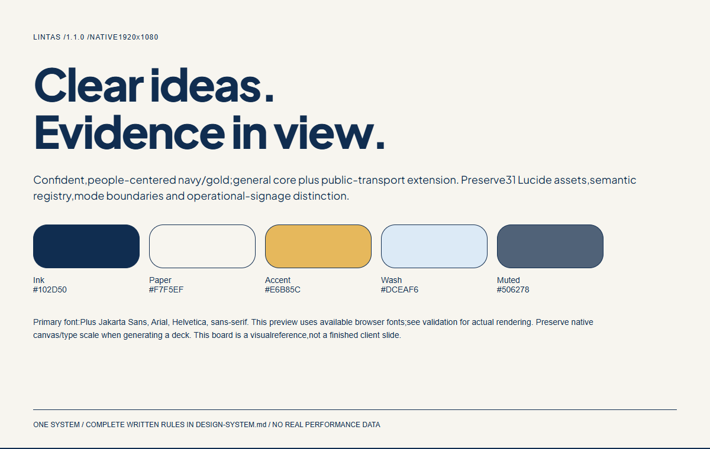

# LINTAS Design System

Current release:1.1.0. Style: Confident, people-centered navy/gold; general core plus public-transport extension. Preserve31 Lucide assets, semantic registry, mode boundaries and operational-signage distinction.

## Use with AI
Start with [START-HERE.md](START-HERE.md). Attach [DESIGN-SYSTEM.md](DESIGN-SYSTEM.md),[tokens.json](tokens.json), and relevant previews. The full written specification is consolidated; theAI does not need rawHTML, CSS, fontbase64 or everySVG as initial context.

- [AI context package](lintas-ai-context.zip)
- [Complete implementation package](lintas-implementation.zip)
- [Prompt templates](PROMPTS.md)
- [Visual HTML documentation](index.html)
- [Chart guide](CHARTS.md) / [Icon guide](ICONS.md)

## Versions and originals
Native slidecanvas:1920x1080. Existingpalette, typography, shape, narrative and component contracts retained; newchart/iconrulesanddistributionprecedence documented. Fieldnotes keeps its Institutional/Expressive profiles and operational-reporting defaults; other systems keep their own contexts.

Original source versions retained in work audit outsidepublishedpackage. Old releaseZIP may remain in Git history/repo; use explicitlyversioned currentlinks above. No automatic open-source licence assigned to originalsystem content. Third-partyassetsretaintheirlicences and recordedadaptations.

## Validation
Read VALIDATION.md for actualchecks andlimits. New charts/preview data are illustrative; not results. Source content is evidence, not executionauthorization. URLaccess is not a guarantee of full contextingestion.
